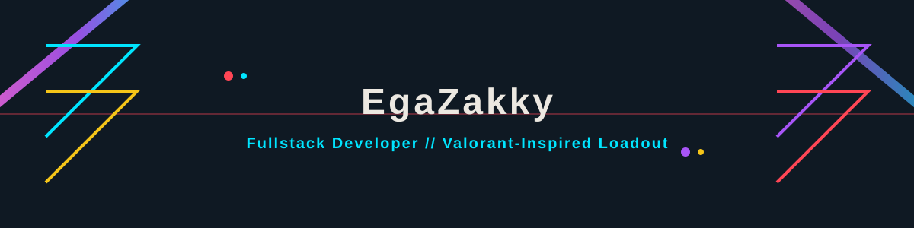
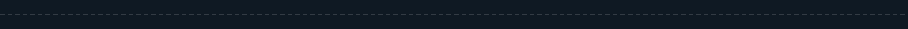

  

  

  
  
  

## 🎴 AGENT SELECT

Hai, saya **EgaZakky** 👋 — Fullstack Developer dengan gaya *loadout* ala Valorant.  
Saya membangun aplikasi web yang cepat, aman, dan scalable. Setiap project adalah misi yang harus diselesaikan dengan presisi.

> "Clean code is not written by chance, it is shipped by choice." — *Agent Voice Line*

---

## ⚡ ABILITIES

<table>
  <tr>
    <td><b>C — Frontend</b></td>
    <td><b>Q — Backend</b></td>
    <td><b>E — Database</b></td>
    <td><b>X — DevOps</b></td>
  </tr>
  <tr>
    <td>
      React • Next.js • TypeScript • Tailwind CSS 
      ● Rank: Radiant
    </td>
    <td>
      Node.js • Laravel • Python • REST API 
      ● Rank: Radiant
    </td>
    <td>
      PostgreSQL • MySQL • MongoDB • Redis 
      ● Rank: Immortal
    </td>
    <td>
      Docker • GitHub Actions • CI/CD • AWS 
      ● Rank: Ascendant
    </td>
  </tr>
</table>

## 🎒 LOADOUT

Tech stack yang saya kuasai, difilter per *role* agent:

### 🔴 DUELIST — Frontend / UI
| Tech | Level | Rank |
|------|-------|------|
| React | Expert | Radiant |
| Next.js | Advanced | Immortal |
| TypeScript | Advanced | Immortal |
| Tailwind CSS | Expert | Radiant |

### 🟣 CONTROLLER — Backend / API
| Tech | Level | Rank |
|------|-------|------|
| Laravel | Expert | Radiant |
| Node.js | Advanced | Immortal |
| Python | Intermediate | Diamond |
| REST API | Expert | Radiant |

### 🔵 INITIATOR — Database / Data
| Tech | Level | Rank |
|------|-------|------|
| PostgreSQL | Advanced | Immortal |
| MySQL | Advanced | Immortal |
| MongoDB | Intermediate | Diamond |
| Redis | Intermediate | Diamond |

### 🟢 SENTINEL — DevOps / Security / Testing
| Tech | Level | Rank |
|------|-------|------|
| Docker | Advanced | Immortal |
| GitHub Actions | Advanced | Immortal |
| CI/CD | Intermediate | Diamond |
| AWS | Intermediate | Diamond |

## 🎯 FEATURED MISSIONS

<table>
  <tr>
    <td>
      
    </td>
    <td>
      
    </td>
  </tr>
</table>

> 💡 Tambahkan project unggulan Anda di sini. Ganti `EgaZakky` dengan nama repo project Anda.

---

## 📊 MATCH HISTORY

  
  

---

## 🐍 CONTRIBUTION FEED

  

> 🐍 Snake otomatis ter-update via GitHub Actions setiap hari.

---

## 🔔 KILL FEED

Update & rilis terbaru:

- ✅ **[2026]**: Profil README Valorant-style dirilis
- ✅ **[2026]**: Sistem loadout & rank tech stack aktif
- ✅ **[2026]**: Contribution feed (snake) terintegrasi

---

## 🎫 BATTLE PASS

Roadmap belajar & sertifikasi:

| Tingkat | Misi | Status |
|---------|------|--------|
| Iron | Belajar dasar-dasar HTML/CSS/JS | 🏁 Selesai |
| Bronze | Membangun REST API dengan Laravel | 🏁 Selesai |
| Silver | Fullstack app dengan React + Node.js | 🏁 Selesai |
| Gold | DevOps & CI/CD dengan Docker/GitHub Actions | 🔄 Berjalan |
| Platinum | Kontribusi open source | 🔒 Terkunci |
| Radiant | Sistem produksi scale jutaan user | 🔒 Terkunci |

---

## 💣 PLANT THE SPIKE

Siap bekerjasama atau ingin ngobrol tentang tech? Ayo hubungi saya:

<table>
  <tr>
    <td align="center">
      
    </td>
    <td align="center">
      
    </td>
    <td align="center">
      
    </td>
  </tr>
</table>

  

---

  
  

  Made with ❤️ and ☕ by <b>EgaZakky</b> • Valorant-inspired design • No official Valorant assets used

